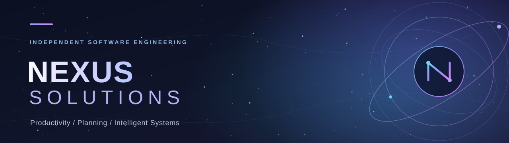
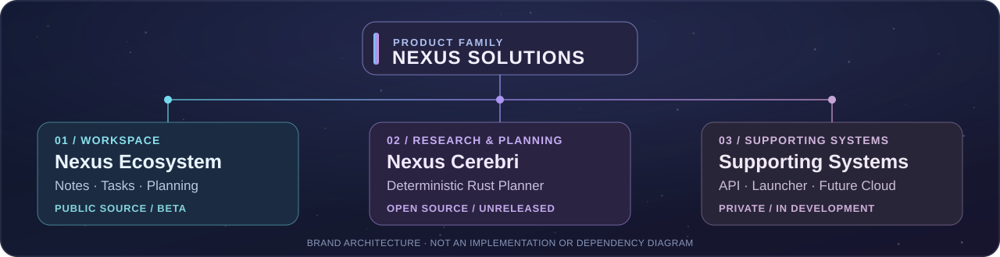
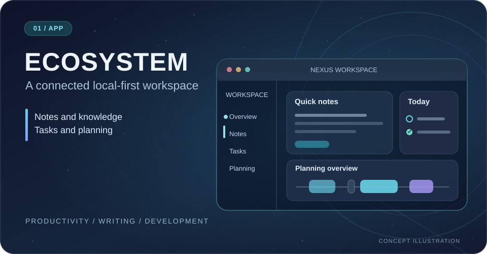
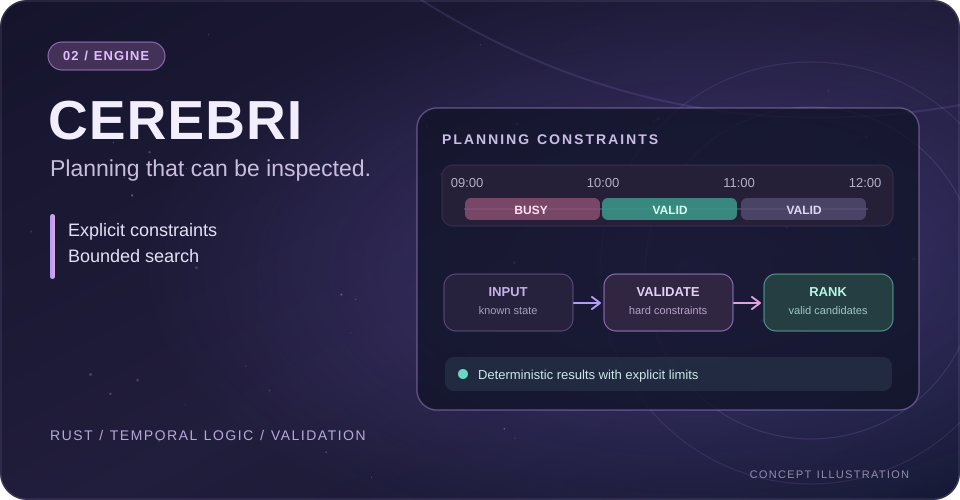

  

  <h3>Building connected software for a smarter future.</h3>

  
Independent software projects spanning <strong>productivity</strong>, <strong>deterministic planning</strong> and <strong>developer experiences</strong>.

  

    <a href="https://nexusproject.dev"><strong>Explore the Workspace</strong></a>
    &nbsp;&nbsp;·&nbsp;&nbsp;
    <a href="#featured-projects"><strong>Featured Projects</strong></a>
    &nbsp;&nbsp;·&nbsp;&nbsp;
    <a href="#engineering-principles"><strong>Our Approach</strong></a>
  

  Independently developed · Open-source where appropriate · Honest about what's shipping

---

## The Nexus family

One name. Different projects. A shared commitment to building software that's useful, understandable and thoughtfully engineered.

  

This is a map of the product family, not a claim that every product already shares one technical runtime.

## Featured projects

<table>
  <tr>
    <td width="50%" valign="top">
      
      <h3>01 · Nexus Ecosystem</h3>
      
<strong>Local-first productivity workspace</strong>

      
One place for notes, tasks, planning, writing and development. Public desktop and mobile clients share an open-core software foundation.

      
<code>TypeScript</code> <code>React</code> <code>Electron</code> <code>Capacitor</code>

      
<strong>Stage:</strong> Beta · active development

      

        <a href="https://nexusproject.dev">Website ↗</a> ·
        <a href="https://github.com/nexus-solutions0/Nexus-Ecosystem">Nexus fork ↗</a> ·
        <a href="https://github.com/YoungJibbit95/Nexus-Ecosystem">Original source ↗</a>
      

    </td>
    <td width="50%" valign="top">
      
      <h3>02 · Nexus Cerebri</h3>
      
<strong>Deterministic temporal planning in Rust</strong>

      
A research-oriented planning foundation with bounded search, typed evidence, explicit constraints and inspectable decisions.

      
<code>Rust</code> <code>Algorithms</code> <code>Temporal Planning</code>

      
<strong>Stage:</strong> Unreleased · release qualification

      

        <a href="https://github.com/nexus-solutions0/Nexus-Cerebri">Nexus fork ↗</a> ·
        <a href="https://github.com/YoungJibbit95/Nexus-Cerebri">Original source &amp; docs ↗</a>
      

    </td>
  </tr>
</table>

Project visuals are conceptual illustrations, not screenshots or demonstrations of released features.

---

## Engineering principles

<table>
  <tr>
    <td width="50%" valign="top">
      <h3>◈ Purpose before features</h3>
      
Design around real workflows and problems worth solving.

    </td>
    <td width="50%" valign="top">
      <h3>◇ Clarity over hype</h3>
      
Keep implemented functionality, beta work and research visibly distinct.

    </td>
  </tr>
  <tr>
    <td width="50%" valign="top">
      <h3>◎ Local-first thinking</h3>
      
Prioritize meaningful local functionality and user control where appropriate.

    </td>
    <td width="50%" valign="top">
      <h3>⬡ Verifiable foundations</h3>
      
Prefer explicit contracts, bounded behavior, tests and clear trust boundaries.

    </td>
  </tr>
</table>

## In development & on the horizon

| Area | Direction |
|:--|:--|
| **Nexus API & Launcher** | Supporting infrastructure and distribution tooling, currently developed in private repositories. |
| **Nexus Cloud / Pro** | Planned and privately developed capabilities; not presented here as generally available. |
| **Cerebri + machine learning** | Future research direction. The current planner remains deterministic; no learned planning runtime is claimed. |

Product status and release readiness are defined by each project's own repository documentation and release process.

---

  <h3>Explore what's being built.</h3>

  

    <a href="https://nexusproject.dev"><strong>Nexus Ecosystem website</strong></a>
    &nbsp;&nbsp;·&nbsp;&nbsp;
    <a href="https://github.com/YoungJibbit95"><strong>Developer GitHub</strong></a>
    &nbsp;&nbsp;·&nbsp;&nbsp;
    <a href="https://github.com/nexus-solutions0"><strong>Nexus GitHub</strong></a>
  

  Built independently. Evolving one thoughtful release at a time.

<strong>Source ownership:</strong> The Nexus Solutions repositories linked as forks are brand-facing copies of projects originally maintained under <a href="https://github.com/YoungJibbit95">@YoungJibbit95</a>. Forks do not update automatically. No private infrastructure code is exposed by this profile.
